  

**Ground your AI before it builds.**  
*Deterministic verification and spec-driven planning MCP server for AI coding assistants.*

[-purple.svg)](https://modelcontextprotocol.io/)
[-3178C6.svg)](tsconfig.json)

---
