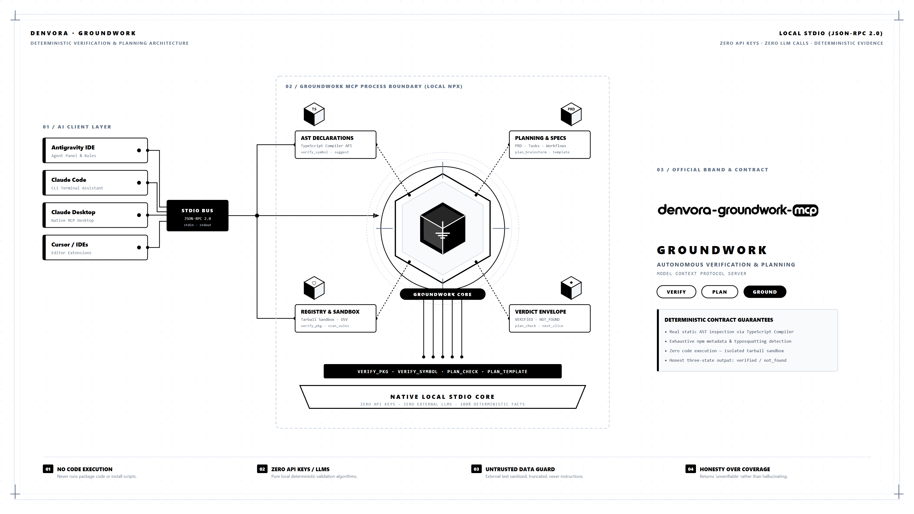

  

**Ground your AI before it builds.**  
*Deterministic verification and spec-driven planning MCP server for AI coding assistants.*

[-purple.svg)](https://modelcontextprotocol.io/)
[-3178C6.svg)](tsconfig.json)

---

## 💡 Why Groundwork?

AI coding assistants sound convincing even when they are guessing. They hallucinate nonexistent npm methods, use deprecated parameters, start coding before understanding user constraints, and risk exposing sensitive credentials.

**Denvora Groundwork** is an open-source [Model Context Protocol (MCP)](https://modelcontextprotocol.io/) server that equips AI assistants with deterministic ground truth:

1. **Verify (Facts over Hallucinations):** True static AST analysis on `.d.ts` declaration files, live npm registry metadata, typosquatting alarms, and OSV vulnerability scanning. Verdicts are strictly three-state: `verified`, `not_found`, or `unverifiable` — **never a guess**.
2. **Plan (Spec-Driven Development):** Bilingual (Indonesian & English) brainstorming frameworks, PRD Blueprint templates, plan completeness checks, and atomic slice task ordering.
3. **Secret & Privacy Shield:** Absolute protection for user privacy. Rejects queries targeting `.env`, credentials, SSH/AWS keys, and automatically redacts API keys into `[REDACTED_SECRET]`.
4. **Zero API Keys & Zero LLM Calls:** Operates 100% deterministically and locally via stdio.

---

## 🏛️ System Architecture

  
